<div align="center">

# ☕ Java OOP Concepts

### Object-Oriented Programming in Java

A structured, visual guide to Java OOP fundamentals — from classes and objects to abstraction, encapsulation, inheritance, polymorphism, and object relationships.


</div>

---

## 📚 Table of Contents

- [Introduction](#-introduction-to-oop)
- [Characteristics of OOP](#-characteristics-of-oop)
- [Class](#-1-class)
- [Object](#-2-object)
- [Constructor](#-3-constructor)
- [Abstraction](#-4-abstraction)
- [Encapsulation](#-5-encapsulation)
- [Association, Aggregation and Composition](#-6-association-aggregation-and-composition)
- [Inheritance](#-7-inheritance)
- [Polymorphism](#-8-polymorphism)
- [OOP vs Procedural Programming](#-oop-vs-procedural-programming)
- [Limitations of OOP](#-limitations-of-oop)

---

## 🎯 Introduction to OOP

**Object-Oriented Programming (OOP)** is a programming paradigm based on objects that contain **data (fields)** and **behavior (methods)**. It helps design software around entities and relationships that can represent real-world concepts.

### Why use OOP?

- ♻️ Improves code reusability.
- 🧩 Enhances maintainability and scalability.
- 🧠 Makes programs easier to understand and manage.
- 🛡️ Supports controlled access to data.
- 🏗️ Helps organize large programs into manageable components.

## 🧭 Characteristics of OOP

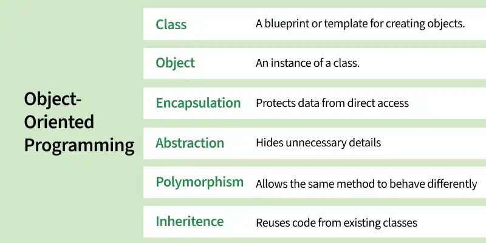

*Diagram: characteristics of OOP.*

---

## 🧱 1. Class

A **class** in Java is a blueprint or template used to create objects. It defines the properties and behaviors that objects of that class have.

- A class is a user-defined reference type.
- It can contain fields and methods.
- Multiple objects can be created from one class.

**Example:** `Car` is a class; BMW, Mercedes, and Audi can be represented as individual car objects.

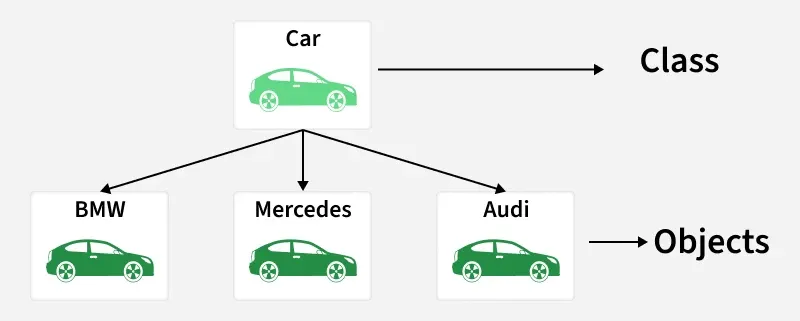

---

## 🐕 2. Object

An **object** is an instance of a class. It has state, behavior, and identity.

| Concept | Meaning |
|---|---|
| **State** | The data or attributes held by the object |
| **Behavior** | The actions the object can perform |
| **Identity** | What distinguishes one object from another |

**Example:** `Dog` is a class, while `Tommy` can be an object created from it.

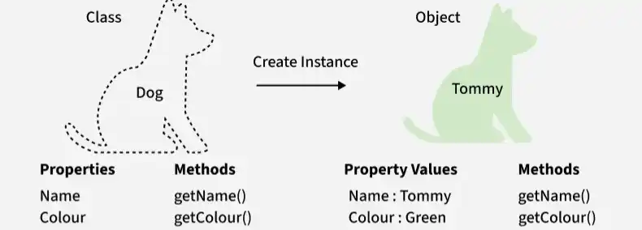

Syntax:

    class Car {

    String brand;
    int speed;

    void drive() {
        System.out.println(brand + " is driving");
        }
    }
    
    public class Main {
        public static void main(String[] args) {

            // 1. Object creation
            Car car1 = new Car();  

            // 2. Assign values to its fields
            car1.brand = "BMW";
            car1.speed = 120;

            // 3. Call its method
            car1.drive();
            System.out.println(car1.speed);
        }
    }


Syntax to remember:

    ClassName objectName = new ClassName();
    objectName.fieldName = value;
    objectName.methodName();


Output:

    BMW is driving
    120


## ```this``` and ``super``

These are important supporting concepts for OOP.

```this``` — current object

    class Student {
        String name;

        Student(String name) {
            this.name = name;
        }
    }


>```this.name``` refers to the object's field; ```name``` refers to the constructor parameter.

```super``` — parent class

    class Animal {
        void eat() {
            System.out.println("Eating");
        }
    }

    class Dog extends Animal {
        @Override
        void eat() {
            super.eat();
            System.out.println("Dog is eating");
        }
    }


```super.eat()``` calls the parent class implementation.

---

## 🏗️ 3. Constructor

A **constructor** is a special class member invoked when an object is created. It initializes the object's state.

### Key rules

- Its name must match the class name.
- It has no return type—not even `void`.
- It is invoked during object creation.
- Constructors can initialize fields and establish a valid initial state.

**Example:** A `Car` constructor can initialize `brand`, `model`, and `color`.

### Types of constructors

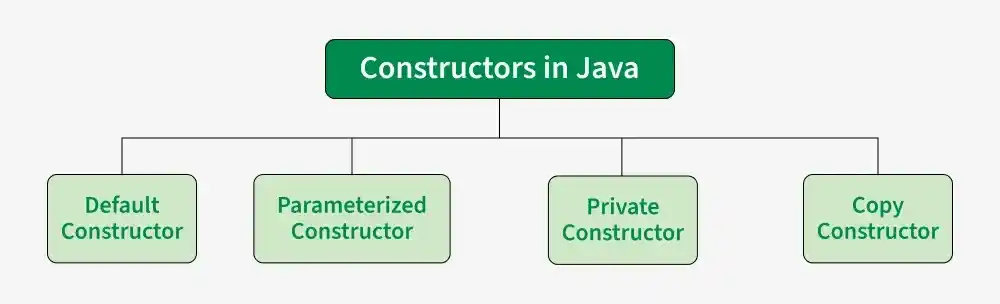

| Type | Description |
|---|---|
| **Default constructor** | The compiler provides one when no constructor is declared; it initializes fields to their default values. |
| **No-argument constructor** | A constructor declared without parameters. |
| **Parameterized constructor** | Accepts parameters to initialize an object with specific values. |
| **Copy constructor** | A user-defined constructor that initializes an object using another object of the same class. Java does not generate one automatically. |
| **Private constructor** | Restricts constructor access from outside the class; often used in controlled-instantiation designs. |

> **Remember:** A compiler-provided default constructor and a programmer-written no-argument constructor are not the same thing.

Syntax: 
    
    class Student {

        String name;
        int rollNumber;

        // No-argument constructor
        Student() {
            name = "Unknown";
            rollNumber = 0;
        }

        // Parameterized constructor
        Student(String name, int rollNumber) {
            this.name = name;
            this.rollNumber = rollNumber;
        }
    }

    public class Main {
        public static void main(String[] args) {
            Student s1 = new Student();
            Student s2 = new Student("Rudraksha", 101);

            System.out.println(s1.name);
            System.out.println(s2.name);
        }
    }

>***Important***: ***this.name = name*** assigns the parameter to the object's field. A copy constructor is also possible in Java, but you must define it yourself.
---

## 🎭 4. Abstraction

**Abstraction** hides implementation details and exposes the essential operations an object provides. It lets users focus on *what* something does rather than *how* it does it.

### Benefits

- Hides unnecessary implementation complexity.
- Makes implementations easier to change.
- Supports flexible designs through abstract classes and interfaces.

**Example:** An ATM provides operations such as withdrawing cash while hiding the internal processing steps.


### How Java supports abstraction
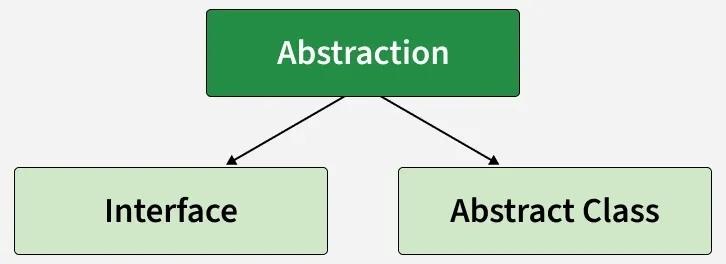
- **Abstract classes** provide a shared base that can contain abstract and implemented methods.

Syntax:

    abstract class Shape {
        abstract double area();

        void describe() {
            System.out.println("I am a shape");
        }
    }

    class Circle extends Shape {
        double radius;

        Circle(double radius) {
            this.radius = radius;
        }

        @Override
        double area() {
            return Math.PI * radius * radius;
        }
    }

    public class Main {
        public static void main(String[] args) {
            Shape shape = new Circle(5);

            shape.describe();
            System.out.println(shape.area());
        }
    }


- **Interfaces** define a contract that implementing classes agree to follow.

Syntax:

    interface Drawable {
        void draw();
    }

    class Rectangle implements Drawable {
        @Override
        public void draw() {
            System.out.println("Drawing rectangle");
        }
    }

    public class Main {
        public static void main(String[] args) {
            Drawable item = new Rectangle();
            item.draw();
        }
    }

Syntax to remember:

    abstract class A { }
    class B extends A { }

    interface X { }
    class C implements X { }


>An interface can contain default, static, and private methods as well as abstract method declarations. It is therefore not strictly limited to 100% abstraction.

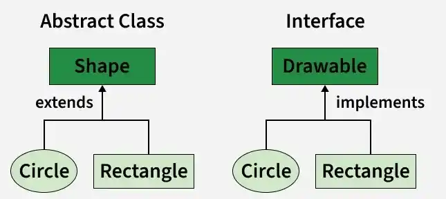

> **Note:** Interfaces are not strictly limited to “100% abstraction”; modern Java interfaces can also contain `default`, `static`, and private methods.

---

## 🔐 5. Encapsulation

**Encapsulation** combines data and the methods that operate on it in one unit, usually a class, while controlling how that data can be accessed.

### Common approach

- Keep fields `private`.
- Expose intentional operations through public methods.
- Use getters and setters when appropriate—not automatically for every field.
- Validate changes so an object remains in a valid state.

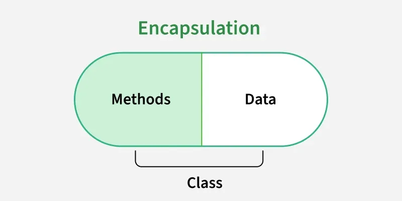

**Example:** A `BankAccount` should not let outside code directly set its balance to an invalid value. Instead, operations such as `deposit()` and `withdraw()` can validate each change.

Syntax: 

    class BankAccount {
        private double balance;

        public BankAccount(double initialBalance) {
            if (initialBalance < 0) {
                throw new IllegalArgumentException("Invalid balance");
            }
            balance = initialBalance;
        }

        public double getBalance() {
            return balance;
        }

        public void deposit(double amount) {
            if (amount > 0) {
                balance += amount;
            }
        }
    }

    public class Main {
        public static void main(String[] args) {
            BankAccount account = new BankAccount(1000);

            account.deposit(500);
            System.out.println(account.getBalance());
        }
    }

>***Output***: 1500.0

>***Syntax to remember***: private fields + public methods that control access. Don't provide a setter automatically if it would allow invalid state.
---

## 🔗 6. Association, Aggregation and Composition

**Association** describes a relationship between objects. The objects may communicate or refer to one another while remaining distinct entities.

### Association

- Represents a relationship between objects.
- Does not inherently imply ownership.
- Related objects can have independent lifecycles.

Syntax:

    class Teacher {
        String name;

        Teacher(String name) {
            this.name = name;
        }
    }

    class Student {
        String name;

        Student(String name) {
            this.name = name;
        }

        void learnFrom(Teacher teacher) {
            System.out.println(
                name + " learns from " + teacher.name
            );
        }
    }

    public class Main {
        public static void main(String[] args) {
            Teacher teacher = new Teacher("Anita");
            Student student = new Student("Ravi");

            student.learnFrom(teacher);
        }
    }

### Aggregation — weak “has-a” relationship

Aggregation is a relationship in which one object refers to or groups other objects that can exist independently.

Syntax:
 
    import java.util.List;

    class Employee {
        String name;

        Employee(String name) {
            this.name = name;
        }
    }

    class Company {
        String name;
        List<Employee> employees;

        Company(String name, List<Employee> employees) {
            this.name = name;
            this.employees = employees;
        }

        void showEmployees() {
            for (Employee employee : employees) {
                System.out.println(employee.name);
            }
        }
    }

    public class Main {
        public static void main(String[] args) {
            Employee e1 = new Employee("Aman");
            Employee e2 = new Employee("Priya");

            Company company =
                new Company("TechCorp", List.of(e1, e2));

            company.showEmployees();
        }
    }
**Example:** A company has employees, but an employee can continue to exist if the company ceases to exist.

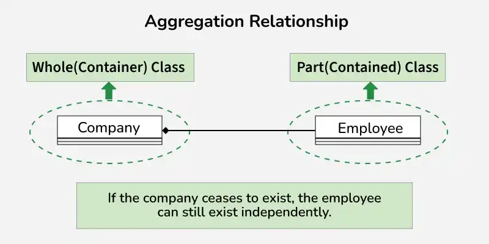

### Composition — strong ownership relationship

Composition represents stronger ownership: the contained object's lifecycle is managed as part of the owning object in the design.

Syntax: 

    import java.util.ArrayList;
    import java.util.List;

    class Room {
        private String name;

        Room(String name) {
            this.name = name;
        }

        String getName() {
            return name;
        }
    }

    class House {
        private final List<Room> rooms = new ArrayList<>();

        House() {
            rooms.add(new Room("Bedroom"));
            rooms.add(new Room("Kitchen"));
        }

        void showRooms() {
            for (Room room : rooms) {
                System.out.println(room.getName());
            }
        }
    }

    public class Main {
        public static void main(String[] args) {
            House house = new House();
            house.showRooms();
        }
    }
**Example:** A house contains rooms as its constituent parts.

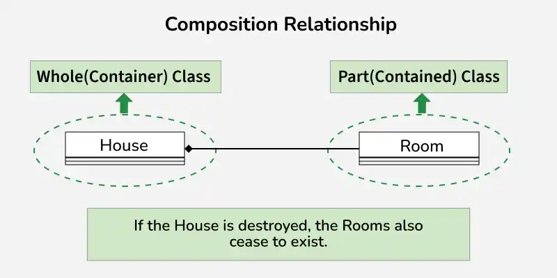

| Relationship | Ownership | Lifecycle |
|---|---|---|
| **Association** | No ownership implied | Independent |
| **Aggregation** | Weak “has-a” relationship | Parts can exist independently |
| **Composition** | Strong ownership | Parts are treated as dependent on the whole |

---

## 🧬 7. Inheritance

**Inheritance** allows one class to acquire accessible fields and methods from another class using `extends`. It commonly represents an **“is-a”** relationship.

- The inherited class is the **superclass** or base class.
- The inheriting class is the **subclass** or derived class.
- A subclass can add behavior and override inherited methods.
- Inheritance can reduce duplication when the relationship is appropriate.

**Example:** `Dog`, `Cat`, and `Cow` can extend an `Animal` base class.

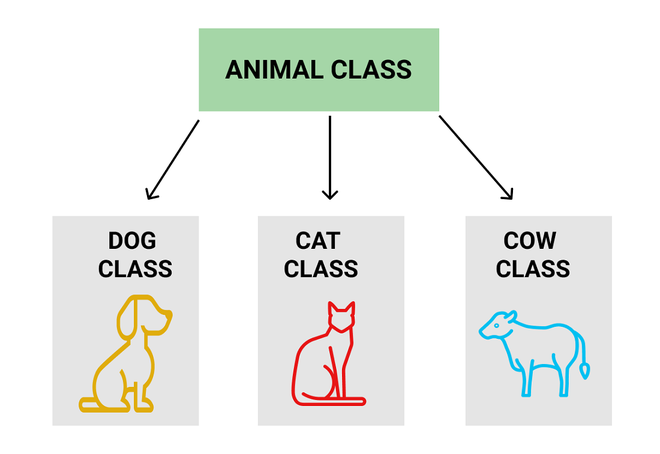

Syntax: 

    class Animal {
        void eat() {
            System.out.println("Animal is eating");
        }
    }

    class Dog extends Animal {
        void bark() {
            System.out.println("Dog is barking");
        }
    }

    public class Main {
        public static void main(String[] args) {
            Dog dog = new Dog();

            dog.eat();   // Inherited method
            dog.bark();  // Dog's own method
        }
    }

Output:

    Animal is eating
    Dog is barking


Syntax to remember:

    class Child extends Parent {
        // Additional fields and methods
    }


Multilevel and hierarchical inheritance

        class Animal { }
        class Mammal extends Animal { }  // Multilevel begins
        class Dog extends Mammal { }

        class Cat extends Animal { }     // Hierarchical branch


>Java classes cannot extend multiple classes, but a class can implement multiple interfaces.
### Types of inheritance

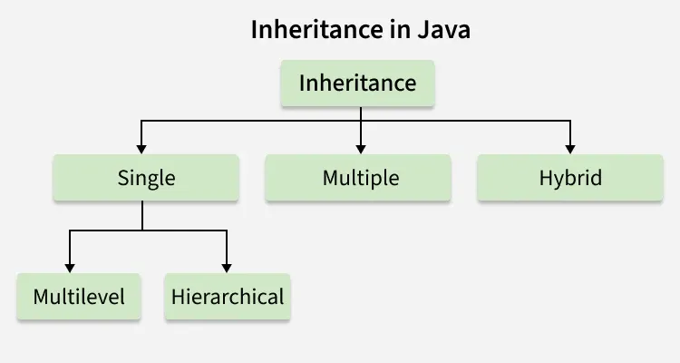

- **Single:** one subclass inherits from one superclass.
- **Multilevel:** inheritance forms a chain of classes.
- **Hierarchical:** multiple subclasses inherit from one superclass.
- **Multiple through interfaces:** a class can implement multiple interfaces.
- **Hybrid through interfaces:** combinations of inheritance structures can be modeled using interfaces.

> **Java limitation:** A class cannot extend multiple classes. Multiple inheritance of type can be achieved by implementing multiple interfaces.

---

## 🎨 8. Polymorphism

**Polymorphism** means “many forms.” The same method call or interface can produce different behavior depending on its parameters or the runtime object's actual class.

### Types of polymorphism

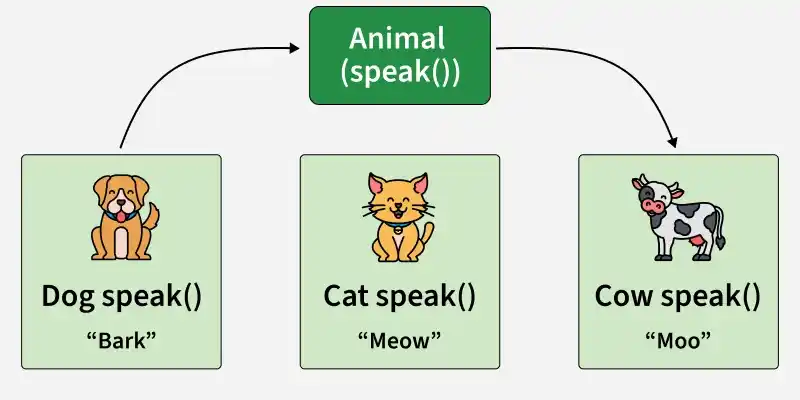

### Compile-time polymorphism — method overloading

Multiple methods share a name but have different parameter lists. The compiler determines which overload matches the call.

Syntax:

    class Calculator {
        int add(int a, int b) {
            return a + b;
        }

        double add(double a, double b) {
            return a + b;
        }

        int add(int a, int b, int c) {
            return a + b + c;
        }
    }

Usage:

    Calculator calc = new Calculator();

    System.out.println(calc.add(2, 3));        // 5
    System.out.println(calc.add(2.5, 3.5));    // 6.0
    System.out.println(calc.add(1, 2, 3));     // 6

### Runtime polymorphism — method overriding

A subclass provides its own implementation of an inherited instance method. The implementation invoked depends on the actual runtime object.

Syntax:

    class Animal {
        void speak() {
            System.out.println("Animal sound");
        }
    }

    class Dog extends Animal {
        @Override
        void speak() {
            System.out.println("Bark");
        }
    }

    class Cat extends Animal {
        @Override
        void speak() {
            System.out.println("Meow");
        }
    }

    public class Main {
        public static void main(String[] args) {
            Animal a1 = new Dog();
            Animal a2 = new Cat();

            a1.speak();
            a2.speak();
        }
    }

Output:

    Bark
    Meow


>***Key distinction***: overloading is resolved from the method signature at compile time; overridden instance-method dispatch depends on the runtime object's class.

**Example:** Calling `speak()` on different `Animal` implementations could produce `Bark`, `Meow`, or `Moo`.

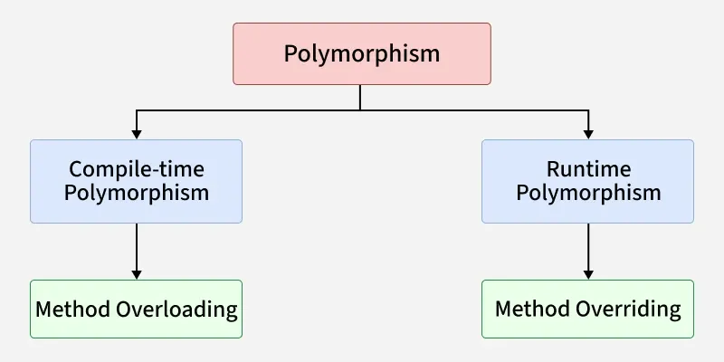

---

## ***11. Access modifiers***
| ***Modifier*** |  ***Access*** |
|---|---|
| public |	Accessible wherever the class/member is visible |
| private	| Within the declaring class
| protected	| Same package and subclasses, subject to Java access rules |
| No modifier |	Same package|

Example:

    class Example {
        public int a = 10;
        private int b = 20;
        protected int c = 30;
        int d = 40; // package-private
    }

## ⚖️ OOP vs Procedural Programming

### Advantages of OOP

- ♻️ **Reusability:** reuse behavior through methods, composition, inheritance, and interfaces.
- 🧱 **Modularity:** divide large systems into classes with clear responsibilities.
- 🛡️ **Encapsulation:** control access to internal state.
- 🔧 **Maintainability:** isolate changes behind stable interfaces.
- 📈 **Scalability:** support larger codebases with explicit abstractions and relationships.

### Limitations of OOP

- 📚 **Learning curve:** classes, object relationships, and polymorphism can be challenging at first.
- ⚙️ **Extra structure:** small programs may not need many classes and abstractions.
- 🧩 **Design complexity:** poor class hierarchies can make systems harder to change.
- 💾 **Memory overhead:** objects and references require memory; the impact depends on the program and runtime.

---

## 📝 Quick Revision Checklist

- [ ] Explain the difference between a class and an object.
- [ ] Describe state, behavior, and identity.
- [ ] Differentiate a default constructor from a no-argument constructor.
- [ ] Explain abstraction and encapsulation with examples.
- [ ] Compare association, aggregation, and composition.
- [ ] Explain single, multilevel, and hierarchical inheritance.
- [ ] Explain why Java classes cannot extend multiple classes.
- [ ] Differentiate method overloading from method overriding.
- [ ] Build a small Java example demonstrating each core OOP concept.

---

<div align="center">

### 💻 Phase 0 — Java Foundations

**Understand the concept. Implement the example. Commit the learning.**

*DAS — Discipline • Algorithms • Solutions*

</div>
